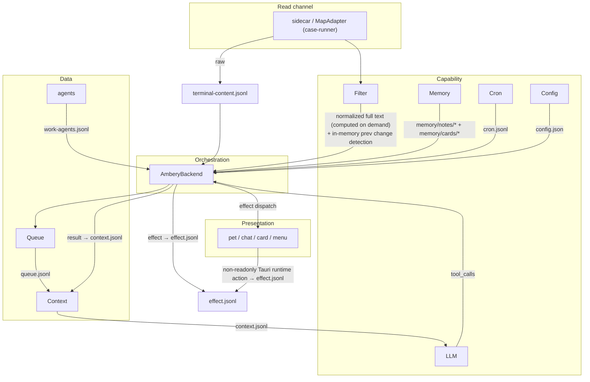

# Module Storage Flow

English | [中文](module-storage-flow.zh.md)

> - **Scope of this document** — this document presents the code-module layering, the processing flow with storage files appearing only on the arrows, and the presentation layer / effect, in two views of the same picture, ASCII and Mermaid. The storage-centric variant is [processing-flow.md](processing-flow.md).

Code module layering + processing flow (storage files appear only on arrows) + presentation layer / effect. Two versions of the same view: ASCII and Mermaid.

## ASCII

```
══════════════════════ module layers ══════════════════════

  Presentation  frontend windows: pet / chat / card-* / menu (Tauri, not headless)
                ├─ store (state layer): the convergence surface of core-owned readable state
                ├─ action layer: write actions + effect reporting
                ├─ window layer: OS window size / position / visibility (adapter + shell)
                └─ rendering layer: DOM building + CSS + size derivation (each type's sizeModel comes from the registry)
  ─────────────────────────────────────────────────────────
  Orchestration AmberyBackend (ambery.rs)
                handle_hook │ handle_timer_scan │ run_trigger │ execute_tool │ drain_queue
  ─────────────────────────────────────────────────────────
  Capability    Filter (filter.rs) │ LLM (llm.rs) │ Timer (timer.rs)
                Lifecycle (lifecycle.rs) │ Memory (memory.rs) │ Cron (cron.rs) │ Config (config/)
  ─────────────────────────────────────────────────────────
  Data          Harness: Queue (queue.rs) │ Context (context.rs) │ EventBuffer (event_buffer.rs) │ agents
  ─────────────────────────────────────────────────────────
  Read channel  terminal package (wt sidecar / zellij CLI) / MapAdapter (case-runner) (external input)
  ─────────────────────────────────────────────────────────
  Storage       JsonlStore (storage.rs) reads and writes storage/*; ConfigStore reads and writes config.json

══════════════════════ processing flow (storage file names appear only on the arrows) ══════════════════════

  External hook / user input
        │
        ▼
  ┌────────────┐
  │ Read chan. │  read Terminal Content
  │ sidecar/   │
  └─────┬──────┘
        │ raw
        │
        ├────────[terminal-content.jsonl]────────▶  raw archive
        │        (fetch_terminal fallback / follow-up computes the digest on demand)
        ▼
  ┌────────────┐   digest → normalized full text (computed on demand, not persisted)
  │ Capability │
  │  Filter    │───▶ change detection (in-memory prev)──▶ changed → notification message
  └────────────┘
        │
        ▼
  ┌────────────┐  enqueue          ┌────────────┐
  │    Data    │─[queue.jsonl]──▶  │    Data    │  release
  │  Queue     │                   │  Context   │
  └────────────┘                   └─────┬──────┘
                                         │ append message
                                         ▼
                                   ┌────────────┐
                                   │ Capability │
                                   │  LLM       │─[context.jsonl]──▶ (assemble head/autonomy/usage)
                                   └────────────┘
                                         │ tool_calls
                                         ▼
                                   ┌────────────┐
                                   │  Backend   │  execute_tool
                                   │ Ambery-    │
                                   └──┬─────┬───┘
                                      │     │
                            result    │     │  effect
                             │        │     │
                             ▼        │     ├────[effect.jsonl]────▶ action stream archive
                      [context.jsonl] │     │  (backend side effects + non-readonly Tauri runtime actions)
                      (tool message)  │     ▼
                                      │  ┌────────────┐
                                      │  │    View    │
                                      │  │ pet/chat/  │
                                      │  │ card/menu  │
                                      │  └────────────┘
                                      │  (RenderComponent/CloseComponent/
                                      │   SetAutonomy/ConfigChanged/
                                      │   AssistantDelta)
                                      ▼
                                 (back to the LLM loop → final reply)

  ── arrows for the remaining modules ↔ storage ──
  [orchestration agents] ──[work-agents.jsonl]──▶  projection (instance lifecycle)
  [capability Memory]    ──[memory/notes/* + memory/cards/*]────────▶  persisted understanding
  [capability Cron]      ──[cron.jsonl]──────────▶  schedule / delay
  [config Config]        ──[config.json]──────────▶  assembly
```

## Mermaid


